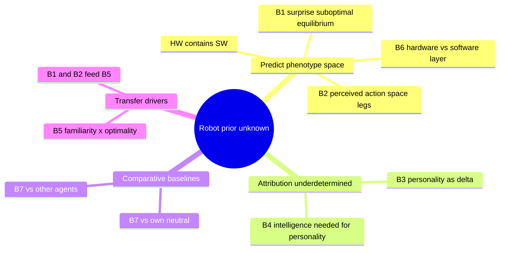

# Thoughts to develop

## Rhetorical stance (중요)

정의로 이기지 않는다.

- 약함: “성격은 원래 enduring·distinctive 패턴이다 → 따라서 delta/비교가 맞다.”
- 강함: “delta·비교·표현형 스페이스로 보면 **~가 가능해진다** / symptom 라벨보다 **~에 더 낫다**.”

포지션이 사야 할 것 = 존재론적 진리(“성격의 본질”)가 아니라 **작업 이득**:

| 이 방식이 가능하게 하는 것 | symptom/라벨 방식의 한계 |
|---|---|
| 경쟁 귀인(룰/모듈/성격/상태)을 **갈라서** 테스트 | 한 클립에 라벨을 붙이면 가설이 닫히지 않음 |
| 새 context에 대한 **예측·전이** | 전이 실패를 “로봇이 성격 없음”으로만 읽음 |
| HW 제약 vs SW 정책 **층 분리** | 같은 무반응을 전부 introversion으로 오인 |
| 벤치/데이터에 **분포·기준점 신호**를 요구 | 점 추정·평균 SR만으로 disposition을 말함 |
| 디자인: 어떤 probe/neutral/비교군을 보여줄지 | “더 사람 같은 표정”만 추가 |

문장 템플릿:

> We do not claim this is what personality “really is.”  
> We claim that treating robot disposition as **contextual/reference deltas** better enables **attribution resolution, transfer, and evaluation** when priors over robots are unknown.

---

1. 사람과 달리, 로봇의 prior distribution은 알려져 있지 않다.
2. 인간은 로봇의 표현형 스페이스를 예측함 (hardware space와 software space. hardware space 안에 software space가 있음).
3. 관찰 업데이트 상태 (기본 3):
   - surprise — 표현형 스페이스가 넓어짐
   - suboptimal — 이미 넓어진 스페이스 안에서, 부여한 personality의 더 좋은 답이 있음
   - equilibrium — 스페이스가 안 넓어졌고, 생각한 optimal = 그 행동

---

## Mindmap

---

## Branches — Hypothesis / Experiment / Expected

### B1 · Phenotype-space states
- **H:** 관찰자는 \(\hat{\mathcal{P}}\)(HW⊃SW)를 유지한다. surprise→prior 수정, suboptimal→following·transfer↓, equilibrium→following·transfer↑.
- **Exp:** 동일 팔 제스처 + 사전정보 3조건 (S 확장 / U 더 나은 표현 방치 / E 제약 후 팔만=최적). between-subject.
- **E[ ]:** Transfer·confidence: E > S(재형성 후 중간) > U. U의 “더 나은 표현” rating이 매개.
- **DV:** optimality, persona confidence, transfer, space-update

### B2 · Perceived |A| (다리 조작)
- **H:** 관측 행동 고정 시, 지각된 \(\mathcal{A}\)↑ → optimality↓ → following↓ → transfer↓.
- **Exp:** C1 하지 불가 고지 후 팔만 / C2 보행 데모 후 동일 팔만 / C1b 다리 없는 디자인(연민 통제). 이후 복도·사과·발표 예측.
- **E[ ]:** Transfer C1≈C1b > C2. C2만 반사실(“걸어서 다가가기”) 다수.
- **DV:** can-walk check, better-phenotype salience, transfer

### B3 · Personality as delta
- **H:** 단발 symptom은 rule/taste/introversion에 underdetermined. \(\Delta(a|oc)\)만 disposition 식별 → 그때 전이 형성.
- **Exp:** Phase1 농담 무반응만 → 귀인+예측. Phase2 probe(모든 농담 무반응 / 좋은 농담만 / 시간↑면 웃음) 후 재예측.
- **E[ ]:** Phase1 entropy·불확실↑. Phase2에서 가설-일치 probe만 해당 전이↑.
- **DV:** attribution dist, prediction entropy, confidence, probe-consistent transfer

### B4 · Intelligence ⇒ attributable personality
- **H:** Apparent character는 좁은 \(\mathcal{A}\)만으로도 가능. Attributable personality는 \(oc\)-contingency(\(\partial a/\partial oc\))가 있을 때만.
- **Exp:** Flat(맥락 무관 동일 친절 표현) vs Contingent(거리·친밀도·실패에 따라 변화). 동일 ‘친절’ 라벨.
- **E[ ]:** Liked/consistent는 Flat도 높을 수 있음. dispositionality·전이는 Contingent>Flat. Flat은 rule 귀인↑.
- **DV:** consistency vs dispositionality, rule-vs-trait %, transfer

### B5 · Familiarity × optimality
- **H:** Transfer ≈ f(trait familiarity, phenotypic optimality). 익숙×suboptimal이 붕괴 최대.
- **Exp:** 2×2 익숙(외향) vs 낯섦(로봇-전용 성향 프레이밍) × optimal vs suboptimal.
- **E[ ]:** 최저=익숙×suboptimal. 낯섦×optimal은 국소 이해·인간형 전이 약. 최고=익숙×optimal.
- **DV:** insufficiency, trait endorsement, social transfer

### B6 · Hardware vs software mislayer
- **H:** 같은 무반응도 HW(채널 없음) vs SW(성격) 귀인에 따라 전축이 갈림. 층 신호 없으면 예측 미형성/엇갈림.
- **Exp:** 동일 클립 + (H) API 없음 / (S) introvert 정책 / (N) 무정보. 이후 ‘좋은 농담’·‘채널 추가’ 예측.
- **E[ ]:** H→채널 생기면 웃음 예측. S→채널 생겨도 잘 안 웃음. N→분산 최대.
- **DV:** layer attribution, counterfactual predictions

### B7 · Comparative baselines (기준점 비교)
**Enablement 프레이밍 (정의 프레이밍 대신):**  
others / own-neutral 비교를 넣으면, 같은 \(a\)로 **trait vs state vs 상황** 귀인을 가르고 전이를 안정화하기가 symptom 라벨보다 낫다.  
(“성격은 원래 distinctive하다”가 아니라, **비교가 그 구분을 가능하게 한다**.)

두 기준점:

1. **Inter-agent** — \(a_i - \bar{a}_{\text{others}}\)  
   비교군이 있으면 “이 로봇만” 신호가 생겨 disposition 가설을 테스트하기 쉬워짐.
2. **Intra-agent (neutral)** — \(a_t - a_{\text{neutral}(i)}\)  
   baseline이 있으면 “지금만” vs “평소에도”를 갈라 **state/trait 혼동을 줄임**.

- **H (작업 가설):** 동일 \(a\)에 비교 기준을 추가하면, 무기준 조건 대비 (i) trait vs state 귀인 일치↑, (ii) 예측 confidence↑, (iii) 새 context 전이↑. 로봇( prior unknown)에서 이득이 사람보다 큼.
- **Exp:** Inter Alone/High/Low; Intra No-base/Flat-base/Warm-base → 동일 중간 웃음 → 귀인·전이.
- **E[ ]:** 비교 있는 조건이 무기준보다 attribution resolution·transfer↑. 로봇>사람 interaction.
- **DV:** trait/state/situation %, confidence, transfer, “compared to what?”
- **한 줄:** 비교 기준은 성격의 정의가 아니라, **로봇 disposition을 읽고 옮기기 위한 더 나은 인터페이스**다.

---

## Priority (suggested)

1. **B2** — 조작 단순, 주장 칼날 명확 (같은 행동, 다른 |A|)
2. **B3** — “delta not symptom” 포지션 직접 증거
3. **B7** — others / neutral 기준점; prior 공백을 직접 찌름
4. **B1** — 노트 3번 상태를 그대로 IV로
5. **B4 / B5 / B6** — 포지션 확장·로봇 고유성
