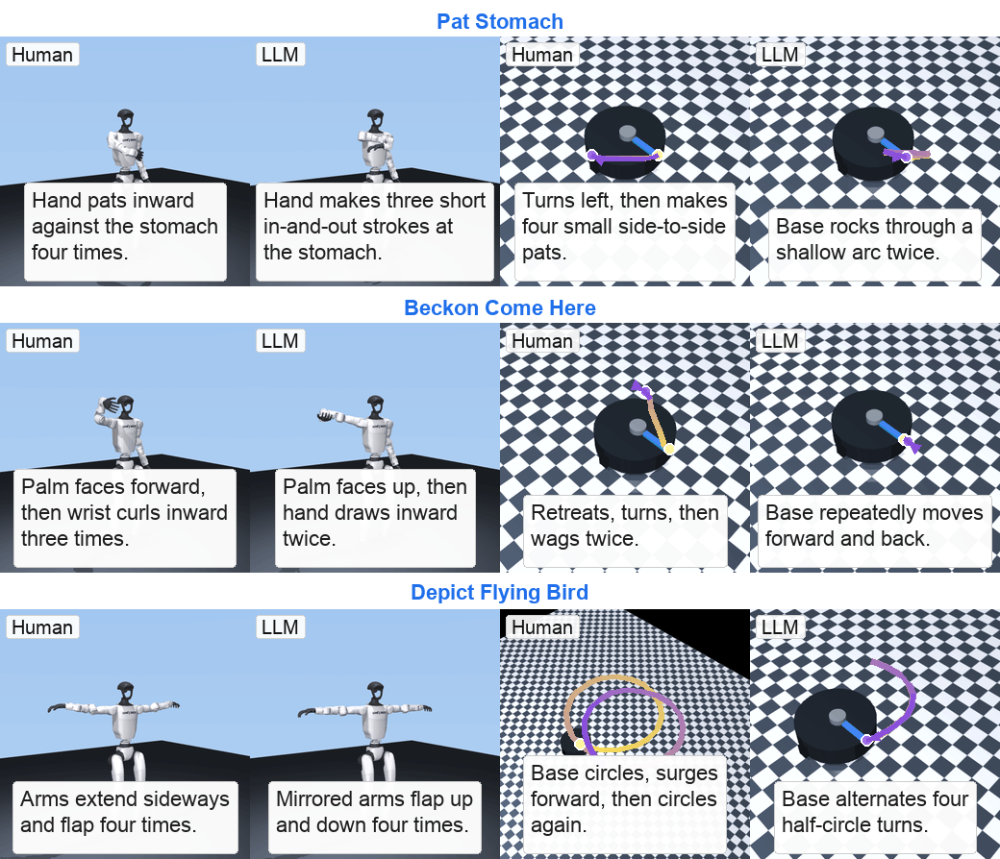

# What Makes a Robot Gesture Recognizable?

Reference code and data for symbolic, LLM-authored gesture generation across
robot morphologies. A shared **Motion Program** exposes pose, movement, path,
and timing attributes, then compiles them into embodiment-specific motion.

The paper studies Unitree G1, PAL TIAGo, KUKA IIWA, Hello Robot Stretch,
Roomba, and three synthetic morphologies (PaddleClaw, TrilegCrown, SpineCrab).

[View the generated-results gallery](https://seunbite.github.io/dev_robosuite/)



## Quick start

```bash
python -m venv .venv
source .venv/bin/activate
pip install -e .
python -m motion_programs.cli validate data/paper
python -m motion_programs.cli compile \
  --platform roomba \
  'pose(dir=front) + path(base, line, x=-0.15) + hold(t=1.0)'
```

Validation and compilation do not require an API key. Rendering requires
MuJoCo and the robot assets documented in [REPRODUCIBILITY.md](REPRODUCIBILITY.md).

## Repository map

| Path | Purpose |
|---|---|
| `motion_programs/` | Stable public Python API and CLI |
| `data/paper/` | Curated programs, schemas, and evaluation summaries |
| `adhoc/generation/robotarm/` | Reference compiler and simulation backends |
| `papers/icra2027_motion_abstraction/` | Paper source and figure/analysis scripts |
| `docs/` | GitHub Pages gallery |
| `tests/` | Parser and program-validation tests |

The large development-time render trees are intentionally excluded. Compact
paper inputs are versioned under `data/paper`; selected results are published
in `docs/`, and media can be rebuilt when the required simulator assets are
available.

## Models and data

The release includes human-authored programs and outputs from Gemini 2.5 Pro
and Qwen2.5-VL variants. Model outputs are snapshots: rerunning an API may not
produce byte-identical programs. Human-evaluation files are anonymized and
contain no participant names or contact information.

## Reproducing results

See [REPRODUCIBILITY.md](REPRODUCIBILITY.md) for the paper-to-code map and
expected outputs. Historical pilots and unsupported experiments are described
in [LEGACY.md](LEGACY.md). This repository is based on robosuite; upstream
attribution and fork details are in [UPSTREAM.md](UPSTREAM.md).

## Citation

Use [CITATION.cff](CITATION.cff). Please also cite robosuite when using the
simulation backend.

## License

Code follows the repository's [LICENSE](LICENSE). Robot meshes, model outputs,
and third-party assets may carry their own terms; verify them before reuse.
